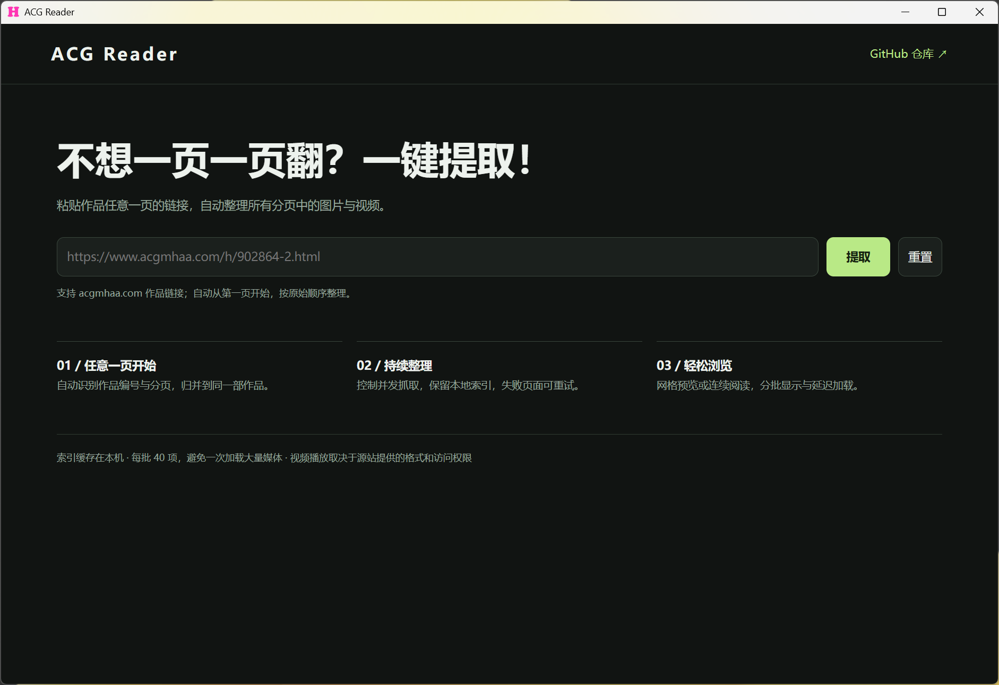

# ACG Reader

输入 ACG 漫画网作品的任意分页链接，即可整理整部作品的图片和视频，支持预览与保存。提供 Windows 和 Android 版本，提取素材需要联网。

ACG漫画网（https://www.acgmhaa.com/）

## 安装

前往 [Releases](https://github.com/differential-operator/acg-reader/releases/latest) 下载最新安装包：

- **Windows 电脑**：下载 `AcgReader-Setup-*-x64.exe`，双击并按提示安装。
- **Android 手机**：下载 `AcgReader-*.apk`，在手机上打开安装；如有提示，允许本次安装来源。

安装后打开 **ACG Reader**，粘贴作品链接并点击“提取”。手机预览图片时，可点击“保存”将当前图片存入相册。
